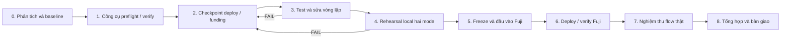

# Kế hoạch thực hiện Solidity: chuẩn bị, triển khai và bàn giao Fuji

Ngày lập: 15/11/2026. Quyết định người dùng khi bắt đầu thực thi: **Fuji dùng DISABLED**; local vẫn kiểm cả MOCK và DISABLED. Nhánh làm việc: `codex/solidity-fuji-handoff`, xuất phát `fix/tich-hop-va-phuc-hoi@b341fa2`. Đầu vào: [bàn giao theo role](ban-giao-sua-loi-2026-11-15.md), SOL-01–SOL-06.

## 1. Phạm vi và kết quả cần đạt

Tạo một bộ công cụ triển khai có thể đối chiếu, chạy thử local bằng token test, rồi bàn giao bundle Fuji được xác minh cho BE/FE. Đọc trạng thái, kiểm input và code/test local có thể làm trước khi có gas. Các bước Fuji cần địa chỉ/ví/gas và cấu hình thực tế; không đánh dấu hoàn thành bằng kết quả local.

Giữ nguyên baseline hiện tại: createPlan permissionless; token mock 6 decimals; MOCK/DISABLED; settlement rút toàn bộ yield đã được nạp tới thời điểm đó, tỷ lệ70/20/phần dư; lịch check-in/refund và nonce/domain hiện hành. Không tự thêm KYC registry, BENQI/Aave, đổi tỷ lệ yield hoặc nâng cấp contract đã deploy.

Không nhận thay role BE việc host DB/API/HTTPS/migration, role FE việc state Flutter/camera/native. Script nghiệm thu local chỉ là công cụ kiểm phần Solidity; kiểm xuyên API/UI cần đầu vào và người review tương ứng.

**Trạng thái lúc lập:** mới đọc code và lập kế hoạch, chưa viết các script đề xuất, chưa chạy lại suite, chưa kiểm số dư hoặc deploy Fuji trong lượt này. Số gas cũ trong bàn giao không được dùng làm số dư hiện tại. Repo chỉ track `.gitkeep` trong shared/deployments, chưa có manifest Fuji đã commit.

## 2. Agent và model

| Vai trò agent | Model / mức suy luận | Trách nhiệm | Quyền sửa khi thực thi |
| --- | --- | --- | --- |
| Phân tích và review độc lập | GPT-6 Astra / high | Phạm vi, rủi ro, dependency, chính sách và gate | Chỉ đọc; không trực tiếp sửa phần mình sẽ nghiệm thu |
| Coding | GPT-6.1 Terra / high | Script/checkpoint/bundle và sửa lỗi được xác nhận | contracts/scripts, package.json; tài liệu API công cụ |
| Testing | GPT-6.1 Sol / high | Test độc lập theo tiêu chí, local rehearsal, phân tích failure | contracts/test, test Solidity và harness local được phân công |
| Tổng hợp | Agent điều phối của chat | Ghép kết quả, kiểm diff, phân loại lỗi, báo cáo cuối | Tài liệu kế hoạch/bàn giao và điều phối sửa; không suy diễn kết quả chưa chạy |

Các model trên đã được dùng để phân tích kế hoạch này. Khi thực thi giữ tối đa ba agent con; coding và testing có thể chạy song song sau khi thống nhất interface, mỗi file có một người ghi. Agent phân tích không tự triển khai mạng. Không cần gọi lại cả ba agent cho sửa tài liệu nhỏ. Model là lựa chọn theo vai trò, không phải bằng chứng code đúng.

Áp dụng karpathy-guidelines cho thay đổi nhỏ, có mục tiêu kiểm chứng; property-based-testing cho invariant tiền/nonce/thời gian. Dùng Hardhat Solidity fuzz hiện có, không thêm framework fuzz mới.

## 3. Hiện trạng và khoảng trống có căn cứ

| Đã có | Việc cần bổ sung/đối chiếu |
| --- | --- |
| Vault đã sửa timestamp/kỳ cuối, test Mocha và fuzz | Chạy baseline đúng commit/Node24; giữ ABI và vector không drift |
| deploy.ts giới hạn chain31337/43113, chờ confirmations, bind adapter | Ghi bằng chứng ngay từng bước; xử lý lỗi dở dang; tránh ghi đè manifest cũ vô ý |
| Manifest có Vault tx hash và vault_code_hash | Receipt/token/adapter/bind và provenance source/compiler; verifier độc lập |
| seed-demo.ts top-up gas/token, kiểm owner/địa chỉ | Kiểm manifest/code/liên kết trước broadcast; lưu từng bước để lần lỗi không làm mất dấu |
| fund-yield.ts kiểm mode/funder, mint→approve→fund | Kiểm position và miền uint256 trước mint; funding cộng dồn, không được coi chạy lại là idempotent |
| export.ts tạo ABI/schema/vector, CI export drift | Bundle checksum/source/deployment liên kết nhất quán; phân biệt vector placeholder và deployment thật |

Vault code hash tự ghi từ chain chỉ là fingerprint của code quan sát được. Nó không tự chứng minh bytecode khớp source. Verifier phải đối chiếu artifact có xử lý immutables/link references hoặc có bằng chứng explorer verify đúng compiler/settings/constructor args. Nếu chưa làm được, ghi source verification còn thiếu.

## 4. Các phase và gate



### Phase 0 — Phân tích, đóng phạm vi và baseline

**Task:** SOL-06, phần chuẩn bị SOL-01. **Agent:** Astra phân tích, testing chạy baseline, điều phối ghi quyết định.

- Đọc manifest/getter/event/typed data, xác nhận nhánh và commit; giữ các file untracked của người dùng ngoài commit.
- Chốt interface script và danh sách file sẽ thay đổi. Không sửa contract nghiệp vụ chỉ để làm tooling tiện hơn.
- Trên Node24 chạy typecheck, contract tests, export và kiểm diff dữ liệu xuất. Tách failure môi trường khỏi regression source.
- Ghi cấu hình compiler từ hardhat.config.ts, optimizer, evmVersion, lockfile và test outputs.

**Đầu ra:** baseline report + work packages có chủ. **Gate:** baseline pass hoặc có lỗi được tái hiện/ghi phạm vi rõ; không bỏ qua test lỗi để tiếp tục deploy. Không lấy số test lịch sử làm lần chạy mới.

### Phase 1 — Coding công cụ kiểm tra trước và sau deploy

**Task:** SOL-01/SOL-03/SOL-06. **Agent:** Terra code; Sol viết test theo contract đầu vào/đầu ra; Astra review thiết kế.

**File mới đề xuất, chưa tồn tại khi lập kế hoạch:**
- `contracts/scripts/preflight.ts`: dùng địa chỉ công khai, read-only provider, không cần getSigners/private key để xem chain và balance.
- `contracts/scripts/verify-deployment.ts`: đọc manifest, kiểm receipt/code/getters và xuất kết quả xác minh.
- `contracts/scripts/lib/deployment.ts`: helper nhỏ dùng chung khi thật sự tránh lặp validation; không xây framework deploy tổng quát.
- `contracts/test/deployment-tools.ts`: test công cụ và ca lỗi quan trọng.

**Tiêu chí:**
- Chain đúng31337/43113 theo môi trường; Fuji bắt buộc43113; treasury/deployer/merchant/subscriber hợp lệ theo vai trò, zero address chỉ cho adapter DISABLED.
- Kiểm mode, token6 decimals, code tồn tại, paymentToken/treasury/adapter và adapter.token/vault/funder, token owner khớp nguồn funding.
- Receipt thành công, block canonical/confirmations; thiếu receipt/timeout trả trạng thái chưa xác định và exit code không thành công.
- Kiểm chi phí theo estimate/budget đã chọn; chỉ thấy balance>0 không được kết luận đủ gas. Seed còn có native-token top-up nên tính cả khoản gửi, không chỉ gas phí.
- Không in secret hoặc URL RPC có credentials; report chỉ chứa public identity/status và lỗi đã lọc.

**Gate:** preflight/verifier có negative tests, bản read-only không gửi transaction. Config Fuji có configVariable private key nên tránh bắt buộc tải signer cho thao tác chỉ đọc.

### Phase 2 — Coding checkpoint và bằng chứng triển khai/funding

**Task:** SOL-02/SOL-03/SOL-05/SOL-06. **Agent:** Terra chủ trì; Sol kiểm failure cases; Astra review độc lập.

**File hiện có:** deploy.ts, seed-demo.ts, fund-yield.ts, package.json. Duy trì manifest trường cũ BE đang dùng, bổ sung provenance tương thích.

- Validate toàn bộ input trước transaction đầu tiên. Với fund-yield kiểm uint256 bounds, position tồn tại/còn principal/Active, đúng token/adapter/funder và owner trước mint.
- Lưu hash ngay khi nhận được; sau receipt bổ sung status/block/hash/address/cost. Phân biệt broadcast/pending/confirmed/reverted/unknown và deployment hoàn chỉnh.
- Deploy ghi token→adapter nếu MOCK→Vault→bind; ghi constructor args công khai, source commit/compiler/settings, runtime fingerprints và ABI checksums. Không xuất một manifest dở dang dưới dạng đã verified.
- Không âm thầm ghi đè fuji.json của deployment cũ. Lưu attempt riêng, chỉ promote bundle hoàn chỉnh sau verifier pass; đường dẫn JSON công khai không chứa khóa/raw transaction.
- Lỗi giữa chừng: dừng, giữ checkpoint và hướng dẫn đối chiếu. Bản đầu không cần tự động resume hoàn toàn; thao tác tiếp phải kiểm lại chain/config/receipt/code và không broadcast lại tx chưa rõ kết quả.
- Seed là top-up nhưng evidence từng bước không được mất. fundYield là thao tác cộng tiền; không tự retry toàn workflow mint/approve/fund sau timeout.

**Gate:** có test mô phỏng lỗi sau mỗi bước chính, evidence giữ được hash; cùng attempt chưa rõ kết quả phải dừng/đối chiếu, không tự nhân đôi funding hoặc redeploy. Một lần nạp mới có chủ đích vẫn được phép; không ép fundYield thành thao tác idempotent.

### Phase 3 — Testing độc lập, review và sửa lại

**Task:** SOL-06. **Agent:** Sol thực thi test; Astra review diff và invariant; Terra sửa lỗi được tái hiện.

- Chạy ma trận ở mục5; ưu tiên invariant mạnh: bảo toàn tổng token, isolation position, principal còn lại, nonce một lần và atomic rollback.
- Assert ca preflight sai không phát sinh tx/số dư thay đổi; không chỉ assert thông báo lỗi.
- Khi review fuzz hiện có, tăng độ mạnh assertion nếu cần: Active/Completed có remaining + released = initial; Refunded đối chiếu thêm ledger refund độc lập. Kiểm tổng yieldOf các position bằng totalYield và nonce tăng đúng một mỗi settlement thành công; revert giữ state/balance/nonce. Hiện suite có kiểm tổng tiền, chưa vì vậy coi mọi invariant riêng đã được phủ.
- Với script timeout/mất receipt xác nhận journal còn hash, chưa promote bundle và không auto gửi lặp.
- Với source/ABI mismatch verifier phải fail; không so hai fingerprint cùng lấy từ chain rồi coi là source verification.
- Định danh failure → sửa → regression fail trên bản lỗi/pass trên bản sửa khi phù hợp → chạy lại scope liên quan. Sau khi suite đủ pass, không chạy lặp toàn bộ vô hạn khi không có thay đổi.

**Gate:** typecheck/build/test/export drift pass, không còn finding gây sai chain, sai đích nhận tiền, funding trùng hoặc báo verified giả. Report ghi số ca thực chạy và output location, không đặt trước số test mới.

### Phase 4 — Rehearsal local từ đầu tới bundle

**Task:** SOL-02–SOL-06 local. **Agent:** Sol chạy; Terra sửa tooling; điều phối kiểm bundle.

**File đề xuất:** `contracts/scripts/rehearsal.ts` hoặc integration test nhỏ tương đương; chọn một cách, tránh hai runner trùng nhau.

- Node loopback31337 riêng; không dùng node mà người khác đang xem demo. Chỉ điều chỉnh thời gian trong local rehearsal.
- Chạy riêng MOCK và DISABLED; deploy/verify, seed, publish, approve và ít nhất hai subscription để tách đường Completed/Refunded.
- Check-in một kỳ, kiểm replay, hoàn tất kỳ cuối ở position A; refund phần chưa dùng ở position B sau boundary. Test refund một phần có trong suite; rehearsal cần đối chiếu ít nhất một lần partial refund hoặc kịch bản riêng nếu chưa được phủ.
- MOCK fund yield có backing, kiểm payout/rounding; DISABLED không có adapter/yield giả. Tổng balance và state khớp trước/sau.
- Thử lỗi giữa bước có checkpoint; verifier phát hiện manifest sai. Chạy lại export không tạo drift bất ngờ.
- Dọn đúng tiến trình/schema do runner tạo; giữ report trước cleanup. Không reset DB/node người khác.

**Gate:** hai mode pass, verifier pass, hash/receipt/balance có evidence, journal/bundle trỏ đúng deployment_id. Local pass không được đánh dấu Fuji pass.

### Phase 5 — Freeze source và hoàn tất đầu vào Fuji

**Task:** SOL-01, chuẩn bị SOL-02. **Agent:** Astra rà gate, điều phối lập checklist; người giữ ví cung cấp đầu vào công khai và ký/mở khóa trên máy của họ khi tới bước thực thi.

- Source/test/export được review và commit để có source_commit ổn định. Nếu thay source sau đó, quay lại phase liên quan.
- Nhóm xác nhận mode MOCK hoặc DISABLED; địa chỉ công khai deployer/treasury/merchant/subscriber; người kiểm soát ví; budget gas/top-up và thời lượng kỳ demo.
- Kiểm lại balance/gas Fuji lúc thực hiện bằng preflight, không dùng số0AVAX trong bản bàn giao cũ như trạng thái hiện tại.
- Chọn cách ký qua cấu hình signer được hỗ trợ hoặc thao tác người giữ ví; không yêu cầu gửi seed/key trong chat. Không cần khóa cho bước read-only.
- Có phương án source verification và lưu constructor/compiler settings. HTTPS UI/API có thể triển khai song song bởi BE/FE; không chặn rehearsal local vì chưa có hosting.

**Gate:** đầu vào đầy đủ và phù hợp scope người dùng cho bước deploy, budget/funder rõ; nếu thiếu chỉ dừng phần phụ thuộc. Lượt lập kế hoạch này không phải yêu cầu triển khai Fuji ngay.

### Phase 6 — Deploy và xác minh Fuji

**Task:** SOL-02/SOL-03. **Agent:** Terra hỗ trợ script; ký bằng signer đã được chủ ví cho phép/cấu hình, chủ ví thao tác khi cơ chế ví yêu cầu; Astra/điều phối kiểm evidence.

- Preflight43113 → deploy theo mode → chờ confirmations cấu hình, hiện mặc định2 → bind nếu MOCK → verifier độc lập.
- Kiểm token owner/decimals, adapter binding/funder, Vault immutables, runtime và receipt từng bước. Source verified bằng phương án Phase1; không đánh dấu pass chỉ vì getCode khác0x.
- Timeout/lỗi: lưu trạng thái và đối chiếu explorer/RPC, không redeploy tất cả tự động. Vault không upgradeable; nếu buộc redeploy ghi deployment_id mới và đánh giá ảnh hưởng vị thế cũ.
- Seed/funding theo budget; không tự phát token/gas ngoài các ví được chọn. Không lưu raw/private key/JWT trong evidence.

**Gate:** deployment pass, nguồn và bytecode có bằng chứng đối chiếu; manifest cuối cùng đồng bộ, không claim có URL HTTPS nếu BE/FE chưa cung cấp. Bàn giao bundle đã verified cho BE/FE ngay Phase6 để họ cấu hình trước Phase7; Phase8 chỉ hoàn thiện evidence và báo cáo cuối.

### Phase 7 — Nghiệm thu user flow thật và phối hợp BE/FE

**Task:** SOL-04/SOL-05. **Agent:** Sol thiết kế/ghi test, UI tổ chức người đóng vai, BE cung cấp API/log, Solidity đối chiếu receipt/accounting.

- Dùng ví Core/MetaMask và môi trường thật đã chọn: merchant publish; subscriber approve/subscribe; subscriber ký EIP-712 QR; merchant release; chặn replay/sai signer/domain; tới thời gian thật thì refund.
- Trên Fuji chờ block/time thật; không dùng evm_increaseTime. Exact timestamp boundary và hai tx cùng block đã kiểm local, không hứa tái tạo deterministically trên Fuji.
- Kiểm Completed/Refunded và số dư theo principal/yield; chụp hoặc lưu hash/receipt, ghi thiết bị/ví/network/commit.
- Test expiry/đổi ví/reload/cancel/speed-up thuộc FE/BE; Solidity xác minh những giao dịch và chữ ký liên quan, không tự nhận sửa REST/controller.
- Để bàn giao môi trường chạy, BE backup/migrate0003, cấu hình bundle và /ready; FE pin chain/Vault/deployment và origin. Solidity giao bundle, không tự host DB/API.

**Gate:** có evidence thực tế từng flow; case chưa đủ thiết bị/HTTPS/ví ghi BLOCKED hoặc NOT_RUN, không lấy injected provider local thay thế.

### Phase 8 — Tổng hợp, nghiệm thu và bàn giao

**Task:** SOL-03/SOL-06. **Agent:** điều phối tổng hợp; Astra kiểm độc lập kết luận, coding/testing xác nhận artifact của mình.

- Báo cáo `docs/solidity-execution-report.md` (đề xuất mới) ghi source/tested/deployed commit, file thay đổi, kết quả local/Fuji riêng, finding đã xử lý và giới hạn còn mở.
- Cập nhật docs/solidity-handoff.md và README; bundle ABI/manifest/EIP-712 có checksum, receipts, compiler/source provenance, public addresses và hướng dẫn token/yield test.
- Fixture shared/check-in.fixture.json là vector cố định placeholder, không thay thành ví/Vault triển khai; tạo ví dụ deployment riêng nếu cần. Không đổi domain test vector để làm giả tương thích.
- Review diff cuối, chỉ stage file thuộc nhiệm vụ. Commit/push/PR/merge theo yêu cầu và quy trình nhóm; không force-push hoặc merge main ngầm.

**Gate hoàn thành:** source/test/tooling local pass + deployment evidence/Fuji flow pass cho phần được yêu cầu + BE/FE nhận cùng bundle. Nếu chưa có gas hoặc môi trường thật, báo hoàn tất phần local và ghi rõ phase Fuji còn chờ, không đánh dấu toàn bộ mục tiêu hoàn tất.

## 5. Ma trận test tối thiểu

| Nhóm | Ca kiểm | Bằng chứng / nơi chạy |
| --- | --- | --- |
| Cấu hình | Sai chain, address zero, mode sai, uint vượt256, source/ABI mismatch | Test công cụ, không broadcast khi preflight fail |
| Liên kết | Token sai/decimals sai, adapter chưa bind/sai Vault, funder/owner sai | Local provider fixtures và getters |
| Receipt | Pending/missing/revert, thiếu confirmations, block/hash không canonical | Test verifier và checkpoint |
| Triển khai lỗi | Lỗi sau token/adapter/Vault/bind; manifest cũ tồn tại | Journal còn hash, không promote/ghi đè bundle hoàn chỉnh |
| Funding | Position không tồn tại/terminal, ID/amount sai, retry sau timeout | Assert tx count/balances; fundYield không được nhân đôi |
| Nghiệp vụ | Allowance, amount, timing, nonce/domain, replay, terminal | Giữ vault.ts hiện có; thêm ca chỉ khi thiếu phạm vi |
| Invariant | Tổng tiền bảo toàn qua nhiều vị thế; adapter principal bằng remaining; terminal principal0 | Conservation.t.sol, giữ fuzz256 mẫu, bổ sung model ledger nếu thiếu |
| ABI/vector | Export lặp không drift, TS/Python/Dart cùng digest | CI contracts, BE/FE đối chiếu khi bundle thay đổi |
| Local lifecycle | MOCK/DISABLED, Completed/refund, rounding và isolation | Rehearsal local báo cáo riêng từng mode |
| Fuji/thiết bị | Signer thật, receipt/code/source, balance và domain thực | Evidence chain43113 và test tổ chức cùng UI/BE |

Không thêm test chỉ lặp lại công thức implementation. Oracle tiền dùng số dư thực, state theo vị thế và ledger principal/yield độc lập. Không dùng generator lọc gần hết đầu vào; boundary có test xác định riêng.

## 6. Lệnh baseline hiện có

Trong `contracts`, Node24 và dependencies đúng lockfile:

```powershell
npm.cmd run typecheck
npm.cmd run build
npm.cmd test
npm.cmd run export
git -C .. diff --exit-code -- shared/abi shared/check-in.types.json shared/check-in.fixture.json shared/check-in.schema.json
```

Nếu shell chưa dùng Node24, gọi executable Node24 cùng tsc/Hardhat CLI hoặc điều chỉnh PATH của riêng tiến trình. Không đổi ExecutionPolicy toàn máy. Dependencies đã cài thì không tự cài lại nếu không cần. Các script preflight/verify/rehearsal ở kế hoạch là đề xuất, chưa có lệnh chạy thực trước khi Phase1/2 hoàn thành.

Export drift so với Git HEAD phù hợp khi ABI chuẩn đã được commit. Nếu code chủ ý thay ABI, review diff/export mới rồi commit cùng source trước khi yêu cầu drift0; không che thay đổi bằng cách restore ABI cũ.

## 7. Checkpoint, trạng thái và vòng sửa lỗi

Mỗi phase lưu: commit + môi trường + người/agent + lệnh + kết quả + evidence paths + findings + gate. Dùng NOT_RUN/RUNNING/PASS/FAIL/BLOCKED trong tài liệu dự án; đây không tự điều khiển trạng thái goal/chat.

Finding ghi mức độ, bước tái hiện, expected/actual, file/function, người nhận và regression. Coding sửa → testing kiểm lại → reviewer đối chiếu → điều phối đóng. Nếu lỗi xuất hiện sau freeze, ghi commit mới và chạy lại các gate phụ thuộc; contract đã triển khai cần đánh giá redeploy.

Theo yêu cầu người dùng: nếu tool cho biết hạn mức5giờ còn **dưới4%** (usedPercent>96 với window300phút), dừng giao việc mới, cho agent dừng ở checkpoint, lưu báo cáo tới thời điểm đó và dừng công việc. Nếu không đọc được quota phải nói không đo được, không đoán theo token context. Báo cáo gồm branch/commit, file chưa commit, test/evidence, dịch vụ/PID do phiên sở hữu và bước tiếp theo; không chứa secret. Không dừng process do người khác sở hữu.

## 8. Đầu vào còn cần trước Phase5/6

- Chọn MOCK/DISABLED cho deployment mục tiêu; baseline kế hoạch giữ nguyên hỗ trợ cả hai.
- Public addresses và người giữ deployer/treasury/merchant/subscriber; cách ký có sẵn.
- Gas/top-up budget và nguồn cấp AVAX Fuji; token là MockUSDC theo script hiện tại.
- Thời lượng period/grace cho demo; không đổi chính sách contract khi chọn giá trị demo.
- URL/origin API/web và lịch nghiệm thu do BE/FE chuẩn bị; phương án source verification.

Không có deadline mới được người dùng xác nhận nên chưa gán ngày hoàn thành. Ưu tiên làm Phase0–4 trước, đồng thời chuẩn bị đầu vào Phase5; chỉ chạy các phase phụ thuộc khi đủ điều kiện.

## 9. Trạng thái kế hoạch

| Phase | Trạng thái thực thi lúc bàn giao kế hoạch |
| --- | --- |
| 0 | Đã phân tích code và phạm vi; baseline test chưa chạy lại |
| 1–4 | NOT_RUN; mới có thiết kế và tiêu chí |
| 5 | Còn đầu vào ví/mode/budget cần chốt |
| 6–7 | NOT_RUN, phụ thuộc Phase5 và môi trường thật |
| 8 | File kế hoạch đã tạo; báo cáo nghiệm thu cuối chưa tạo |