# User flows — Vận hành và ngoại lệ

> Design draft 0.2 — có sơ đồ trực quan. Tất cả flow về kỳ và refund phụ thuộc B1–B6 trong project.md.
> Các path API relative với /api/v1. Chủ ví ký, blockchain xác nhận, backend chỉ đối chiếu/lưu read model.

## Hướng dẫn đọc sơ đồ

Các ảnh PNG được nhúng ngay dưới từng mục, dùng được trên GitHub và trình xem Markdown không hỗ trợ Mermaid. SVG cho chất lượng vector; Mermaid (.mmd) cho chỉnh sửa logic. Xanh dương = bước xử lý; vàng = điều kiện; nhánh đỏ = lỗi/chưa đủ điều kiện/chờ; xanh lá = kết quả của luồng (không phải lúc nào cũng là thanh toán).

Tất cả sơ đồ mô tả thiết kế dự kiến, không chứng minh hệ thống đã triển khai. Nhãn sơ đồ bằng tiếng Anh; phần giải thích chi tiết bằng tiếng Việt. Sơ đồ yield/refund dùng baseline B1–B6 cần nhóm chốt.

Nguồn chung: [flows.json](diagrams/flows.json). Tạo lại PNG/SVG/Mermaid bằng `uv run docs/diagrams/generate_diagrams.py` từ repo root. Script chỉ chạy local; Pillow được khai báo bằng PEP 723. Không sửa ảnh trực tiếp nếu muốn giữ các định dạng đồng bộ.

## 1. Trạng thái dùng chung

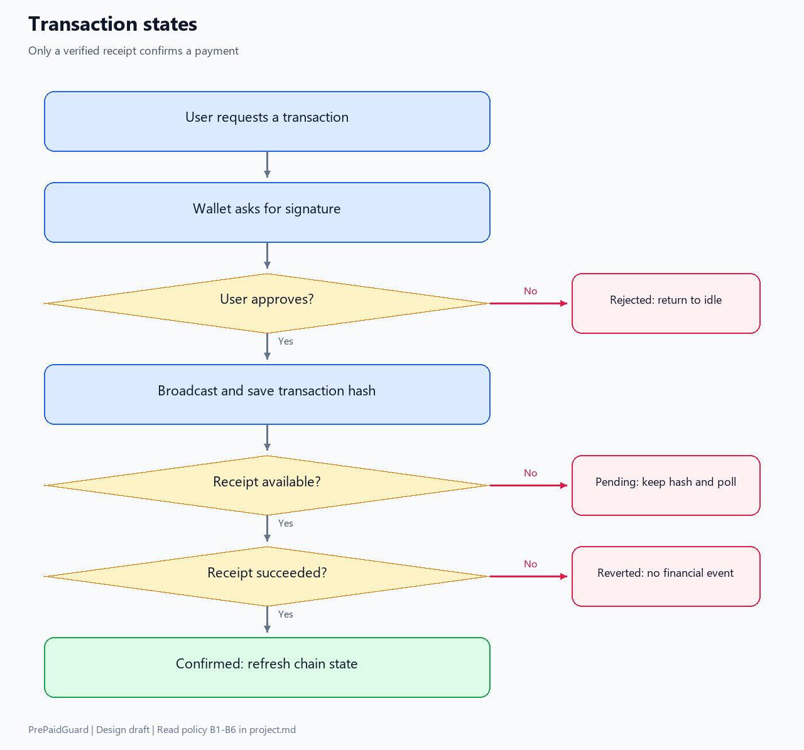

[Sơ đồ SVG](diagrams/01-transaction-state.svg) · [Mã Mermaid](diagrams/01-transaction-state.mmd)

UI transaction: IDLE → AWAITING_SIGNATURE → SUBMITTING → PENDING → CONFIRMED hoặc FAILED.
Người dùng từ chối ký: quay IDLE, không phải thất bại tài chính.
RPC timeout/mất mạng: UNKNOWN/PENDING với tx hash nếu có; tra lại trước retry.
Backend TransactionRecord: SUBMITTED → CONFIRMED hoặc REVERTED; UNKNOWN trên UI không đồng nghĩa revert.

Subscription: chưa đăng ký → ACTIVE → COMPLETED hoặc REFUNDED.
Plan draft: DRAFT → PUBLISHED sau PlanCreated đã verify.
Không có process tự động chuyển tiền chỉ vì thời gian trôi qua: contract chỉ thực thi khi có transaction.

## 2. Khởi động app và kiểm cấu hình

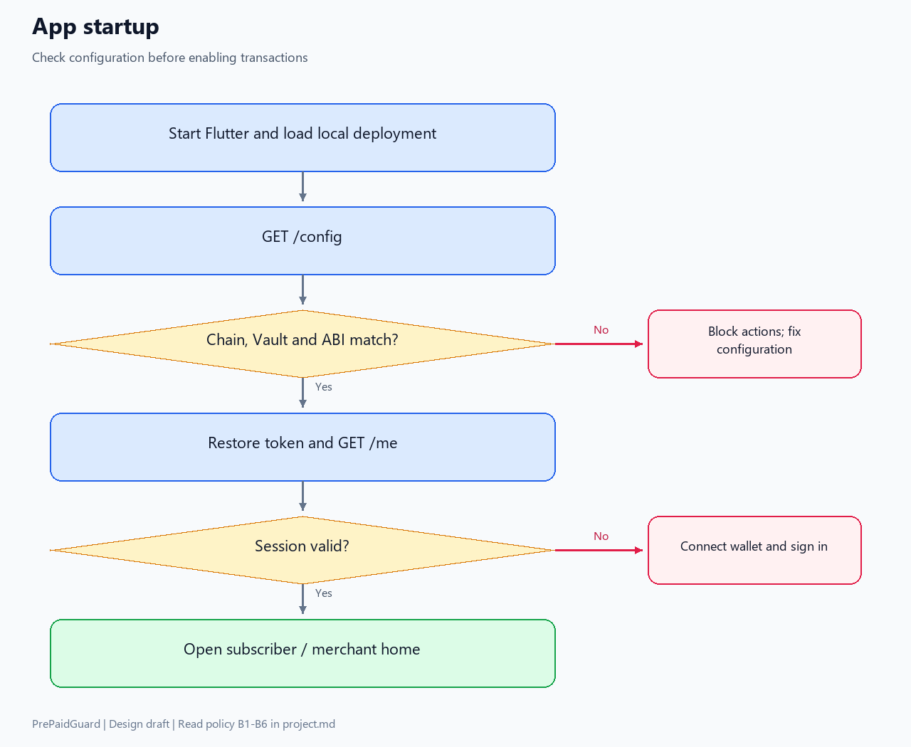

[Sơ đồ SVG](diagrams/02-app-start.svg) · [Mã Mermaid](diagrams/02-app-start.mmd)

1. Flutter đọc deployment/ABI local và GET /config.
2. Kiểm chain_id, Vault, token, ABI version và deployment_id khớp; mismatch thì khóa gửi giao dịch.
3. Restore session nếu còn hạn, GET /me; nếu 401 xóa session và yêu cầu login.
4. Chọn giao diện subscriber/merchant. Đây là điều hướng, không cấp quyền.
5. Hiển thị testnet + token thử nghiệm + yield mode rõ ràng.

Lỗi API: không giả dữ liệu thành dữ liệu thật; cho retry. Ví sai chain: yêu cầu đổi network trước khi ký hoặc approve.
Public config không chứa RPC credential. Chưa có ABI/deploy hợp lệ thì hiển thị môi trường chưa sẵn sàng.

## 3. Kết nối ví và đăng nhập

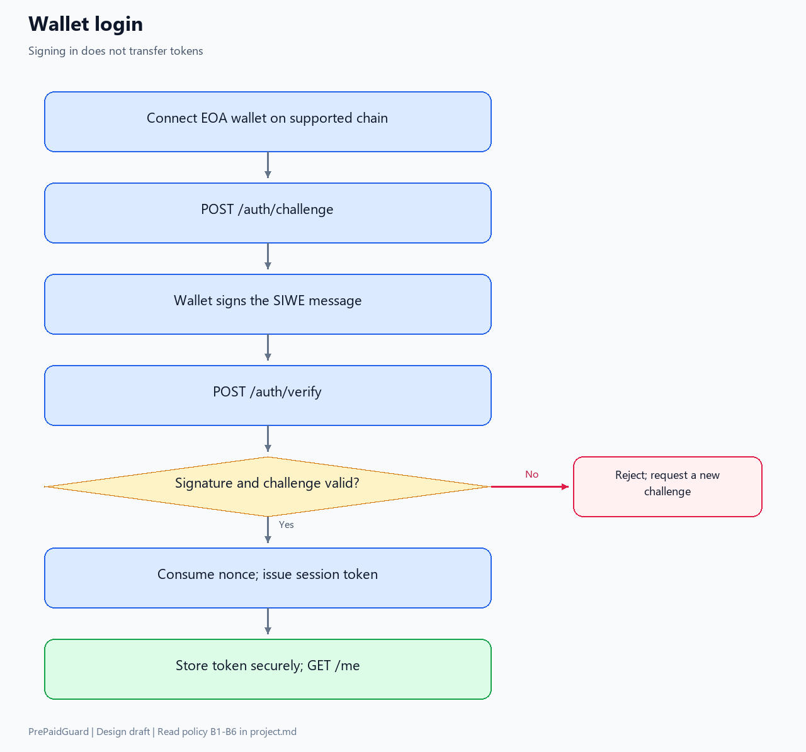

[Sơ đồ SVG](diagrams/03-wallet-login.svg) · [Mã Mermaid](diagrams/03-wallet-login.mmd)

1. Subscriber/merchant kết nối ví bằng SDK đã kiểm chứng trên Android.
2. POST /auth/challenge với ví + chain.
3. Ví hiển thị SIWE message và người dùng xác nhận ký; không yêu cầu quyền chuyển token.
4. POST /auth/verify với challenge_id + signature.
5. Lưu access token trong secure storage, GET /me để nạp profile.
6. Hết hạn → ký challenge mới. Đổi ví → bỏ JWT/QR cũ và login lại.
7. Logout → POST /auth/logout rồi xóa token local; nếu mạng lỗi vẫn xóa local.

Sai chữ ký, challenge hết hạn hoặc dùng lại: lấy challenge mới, không tự ký ngầm.
MVP EOA; contract wallet/embedded wallet chưa được coi là hỗ trợ cho đến khi test thành công.

## 4. Merchant onboarding

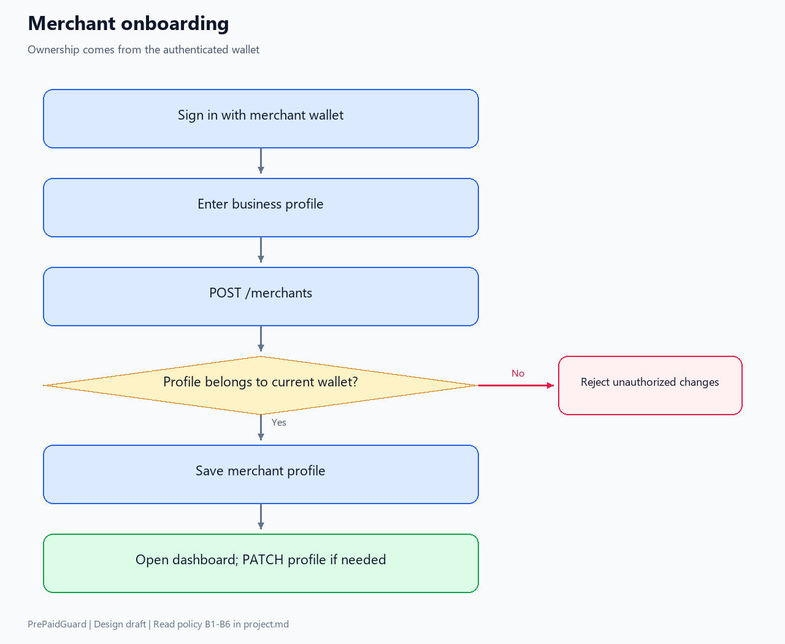

[Sơ đồ SVG](diagrams/04-merchant-profile.svg) · [Mã Mermaid](diagrams/04-merchant-profile.mmd)

1. Ví đã login chọn tạo merchant.
2. Nhập business_name, description, location_text; POST /merchants.
3. Backend gắn owner từ session, không từ form.
4. Dashboard hiển thị profile và danh sách gói của merchant.
5. Sửa hồ sơ qua PATCH /merchants/{id}.

Kết quả: có profile; chưa tạo plan, chưa nạp/rút token. Không có xác nhận pháp lý tự động.

## 5. Tạo và publish gói

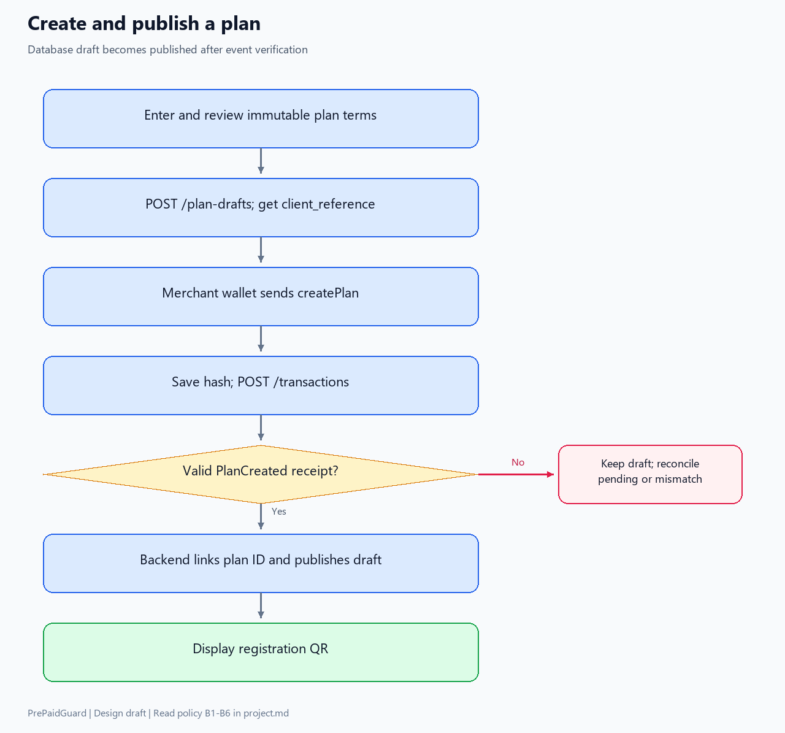

[Sơ đồ SVG](diagrams/05-publish-plan.svg) · [Mã Mermaid](diagrams/05-publish-plan.mmd)

1. Merchant nhập title, description, giá mỗi kỳ, số kỳ, duration và grace.
2. UI hiển thị tổng gốc và chính sách refund trước submit.
3. POST /plan-drafts → nhận id, client_reference, total_price.
4. Merchant xem lại; khóa chỉnh sửa draft trong lúc publish.
5. Ví merchant gọi createPlan với client_reference và terms đúng draft.
6. Mobile giữ tx hash và POST /transactions action=CREATE_PLAN, plan_draft_id.
7. Chờ receipt; backend đối chiếu event/terms, gắn onchain_plan_id và chuyển draft PUBLISHED.
8. Hiển thị QR đăng ký + plan ID. QR mở deep link nếu app đã cấu hình; luôn có phương án scan trong app/nhập ID.

Hủy ký: draft vẫn DRAFT. API timeout sau broadcast: tra hash, không tạo plan lần nữa.
createPlan trùng client_reference bị chặn. Event terms không khớp draft: hiển thị lỗi cần đối chiếu; không gán plan tùy tiện.

## 6. Khách xem và đăng ký gói

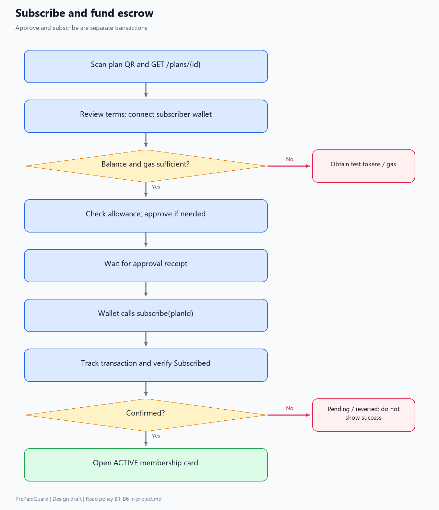

[Sơ đồ SVG](diagrams/06-subscribe.svg) · [Mã Mermaid](diagrams/06-subscribe.mmd)

1. Quét Registration QR, chỉ chấp nhận host/network/Vault trong allowlist.
2. GET /plans/{id}; kiểm network và đọc financial terms on-chain qua cấu hình đã biết.
3. Hiển thị merchant, tổng gốc, kỳ đầu, duration, grace, refund policy và MOCK yield.
4. Khách login/kết nối ví; xác nhận đã hiểu điều khoản.
5. Kiểm balance token, AVAX gas và allowance.
6. Nếu thiếu allowance, ví gọi ERC20.approve đúng token/Vault/số tiền; chờ receipt.
7. Ví gọi subscribe(planId). Đây là transaction thứ hai, tách approve khỏi subscribe.
8. POST /transactions action=SUBSCRIBE, plan_id; chờ confirmed và lấy subscription ID từ event.
9. Refresh /me/subscriptions và mở thẻ hội viên.

Token thiếu: hướng dẫn dùng token test theo demo, không tích hợp nạp tiền thật.
Approve thành công nhưng subscribe fail: chưa có subscription/tiền gốc chưa nạp; allowance có thể vẫn còn. UI không báo "đăng ký thành công".
App đóng sau broadcast: restore pending tx và scanner tìm event theo ví. Double tap bị khóa; hai subscribe hợp lệ có thể tạo hai gói, nên luôn đối chiếu pending trước ký lại.

## 7. Thẻ hội viên và lịch sử

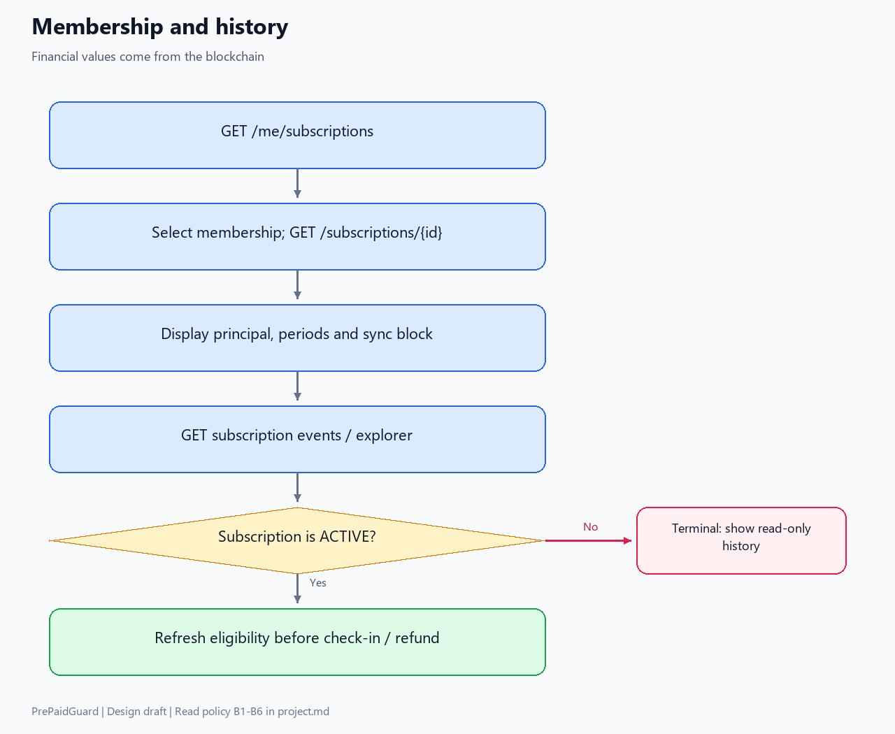

[Sơ đồ SVG](diagrams/07-membership.svg) · [Mã Mermaid](diagrams/07-membership.mmd)

1. GET /me/subscriptions → chọn gói → GET /subscriptions/{id}.
2. Hiển thị gốc ban đầu/còn lại, completed_periods/total_periods, next_release_at, refund_available_at, status, sync block và yield mode.
3. GET /subscriptions/{id}/events để xem release/refund và explorer.
4. Chỉ bật thao tác phù hợp; trước thao tác luôn refresh eligibility.
5. COMPLETED/REFUNDED hiển thị lịch sử, khóa check-in/refund tiếp.

Estimated yield chỉ là estimate. Không biến animation bộ đếm thành số dư rút được.

## 8. Khách tạo QR check-in

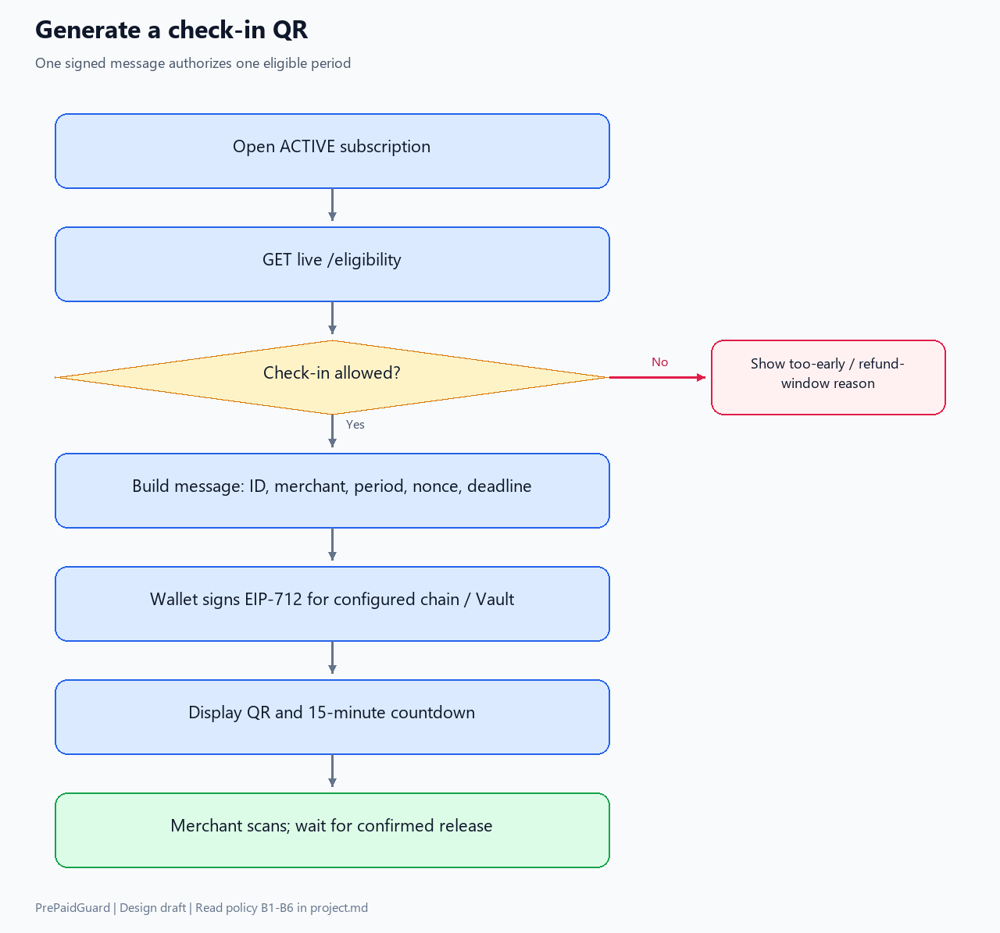

[Sơ đồ SVG](diagrams/08-check-in-qr.svg) · [Mã Mermaid](diagrams/08-check-in-qr.mmd)

1. Gói ACTIVE; GET /subscriptions/{id}/eligibility bằng dữ liệu live.
2. Nếu chưa tới kỳ hoặc cửa sổ refund đã mở, giải thích lý do và không yêu cầu ký.
3. Tạo message đúng schema.md: subscriptionId, merchant, periodIndex, nonce, deadline.
4. Ví ký EIP-712 với domain chain/Vault đúng config.
5. Hiển thị Check-in QR và countdown 15 phút.
6. Khách đưa QR cho merchant. Đây chưa phải bằng chứng tiền đã chuyển.
7. Sau khi nhận/đọc trạng thái mới, refresh gói.

QR hết hạn: refresh nonce/eligibility và ký mới có xác nhận người dùng. Không silent re-sign mặc định.
MVP yêu cầu mạng cho refresh/SDK; không cam kết offline. Tạo lại QR không hủy mã cũ chưa dùng; nonce ngăn chi tiền lặp.

## 9. Merchant quét và giải ngân

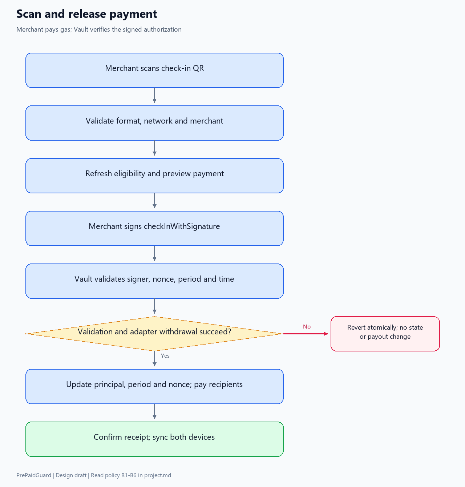

[Sơ đồ SVG](diagrams/09-merchant-scan.svg) · [Mã Mermaid](diagrams/09-merchant-scan.mmd)

1. Merchant login đúng ví tạo plan, camera có quyền truy cập.
2. Scan JSON: kiểm kind/version/size, chain, Vault và merchant address.
3. Parse và verify chữ ký cục bộ nếu SDK hỗ trợ; fetch live eligibility trước gửi. Contract vẫn quyết định cuối.
4. Hiển thị khách/gói/kỳ và số gốc sẽ giải ngân; merchant xác nhận.
5. Ví merchant gọi checkInWithSignature(message, signature), merchant trả gas.
6. Vault kiểm merchant caller, signer=subscriber, status ACTIVE, nonce, periodIndex, deadline và ranh giới kỳ/refund.
7. Cập nhật nonce/completed_periods/gốc; rút đúng tiền từ adapter; chia gốc/yield nguyên tử.
8. Nếu hết kỳ → COMPLETED, else next_release_at=block.timestamp+periodDuration.
9. Mobile POST /transactions action=CHECK_IN, subscription_id.
10. Chỉ khi chain xác nhận mới báo thành công, refresh cả hai thiết bị.

Scan trùng: scanner debounce; contract nonce chặn trùng ngay cả hai thiết bị gửi đồng thời.
Sai merchant, QR hết hạn/khác Vault, sai nonce: từ chối; xin khách tạo lại nếu phù hợp.
Adapter không đủ tiền: revert toàn bộ; không tăng kỳ hoặc mất quyền refund do lỗi.
Merchant camera lỗi: cho nhập/dán payload QR trong app để thử demo, vẫn phải verify và ký; không bỏ bước contract.

## 10. Refund theo baseline đang đề xuất

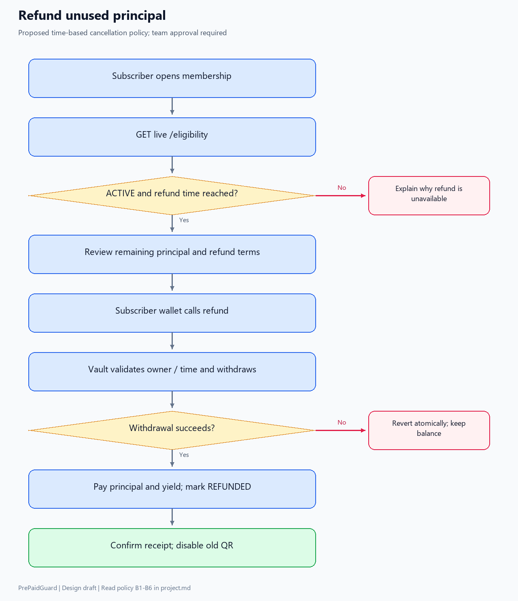

[Sơ đồ SVG](diagrams/10-refund.svg) · [Mã Mermaid](diagrams/10-refund.mmd)

1. Khách mở gói và xem refund_available_at.
2. GET eligibility live: chỉ ACTIVE, đúng hạn và đúng ví.
3. UI ghi rõ đây là hủy theo điều kiện thời gian đã thỏa thuận, không tuyên bố chứng minh gym đóng cửa.
4. Xác nhận số gốc còn lại và yield mode, không cam kết 100% vốn an toàn khi tích hợp DeFi thật.
5. Ví subscriber gọi refund(subscriptionId), trả gas.
6. Contract kiểm caller và timestamp >= refund_available_at, set REFUNDED, tăng nonce, remainingPrincipal=0.
7. Adapter rút gốc còn lại về subscriber; yield chia 70/20/10, toàn bộ giao dịch nguyên tử.
8. POST /transactions action=REFUND, subscription_id; confirmed thì đóng gói và hiển thị receipt.
9. QR cũ và check-in sau refund bị từ chối.

Refund trước hạn hoặc bởi ví khác: revert. RPC timeout: giữ pending, không coi tiền đã nhận.
Tại đúng refund_available_at: refund được phép, check-in bị chặn. Nếu nhiều tx cạnh tranh, contract xử lý theo trạng thái thực lúc chạy, không theo UI cũ.

## 11. Yield mô phỏng

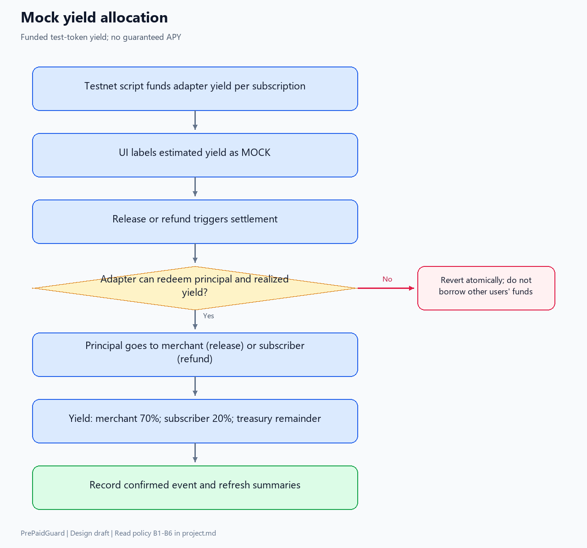

[Sơ đồ SVG](diagrams/11-mock-yield.svg) · [Mã Mermaid](diagrams/11-mock-yield.mmd)

1. Script testnet cấp token lãi cho mock adapter ngoài phần gốc, hạch toán theo subscription.
2. UI lấy estimate và lũy kế payout; label MOCK rõ ràng.
3. Release/refund realize và phân bổ yield có backing.
4. Gốc trả merchant cho release hoặc subscriber cho refund.
5. Không có endpoint public mint, claim riêng hay lãi suất cố định trong MVP.

Nếu tắt yield: mode DISABLED, các phần yield bằng 0, escrow vẫn chạy đủ luồng.

## 12. Mất mạng, app đóng và dữ liệu trễ

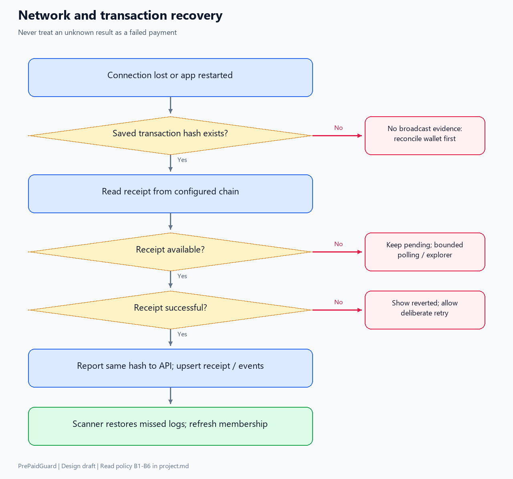

[Sơ đồ SVG](diagrams/12-recovery.svg) · [Mã Mermaid](diagrams/12-recovery.mmd)

| Tình huống | Xử lý |
| --- | --- |
| Chưa broadcast mà mất mạng | Giữ form; chưa có giao dịch; người dùng chủ động thử lại |
| Đã có tx hash nhưng API lỗi | Lưu hash local, poll receipt và báo backend khi có mạng |
| POS scan offline | Chỉ ghi nhận tạm; không báo đã thanh toán hoặc hứa submit sau khi QR hết hạn |
| QR hết hạn trong lúc mất mạng | Xin chữ ký mới khi có mạng; không đổi deadline trên chữ ký cũ |
| DB projection chưa cập nhật | Hiển thị syncing, dùng live receipt/state cho thao tác quan trọng |
| RPC chưa thấy transaction | Trạng thái chưa rõ, không tự gửi lần hai |
| Vault deploy mới | Config mismatch chặn giao dịch; không dùng QR/ID của deployment cũ |

Backend scanner chạy quét log theo deployment block; event upsert theo chain/Vault/tx/log để không trùng. Không cần người dùng báo lại mọi transaction để lịch sử tồn tại.

## 13. Kịch bản demo nghiệm thu

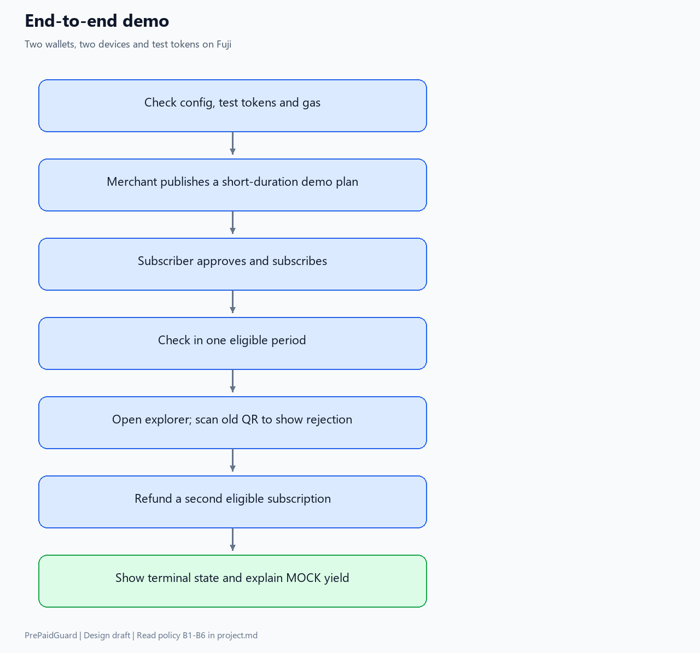

[Sơ đồ SVG](diagrams/13-demo.svg) · [Mã Mermaid](diagrams/13-demo.mmd)

- Ví merchant và subscriber khác nhau, hai thiết bị hoặc hai phiên ví thật.
- Publish plan và subscribe bằng MockUSDC.
- Dùng plan có duration/grace ngắn đã công khai dành cho demo.
- Check-in một kỳ, mở explorer, quét lại chứng minh bị từ chối.
- Với subscription khác đã đủ hạn, refund và chứng minh không check-in tiếp được.
- Nêu rõ phần chạy thật trên Fuji, phần yield mô phỏng và các tính năng chưa làm.
- Chuẩn bị token/gas, bản app và video dự phòng; không dùng chức năng sửa thời gian tùy ý trên Fuji.
